# Mapa del repo

Para que una sesion nueva entienda el dossier "Nissan en 23 reseñas" sin perder el hilo: **que es, como
esta armado, que parte de `index.html` es dueña de que y que tocar para cada cambio comun**. Verificado
contra el codigo el 16/10/2026; las referencias `index.html:linea` son de esa fecha y se corren con
cualquier edicion, asi que buscá por el nombre (`var VIDEOS=`, `id="prendario"`) antes que por el numero.

## 1. Que es y como esta armado

Un dossier estatico de una sola pagina sobre la gama Nissan en la Argentina (Kicks, Kait, Versa, Sentra y
Frontier), con corte al 30/09/2026. **Todo el sitio es un unico `index.html`** (~2,2 MB): CSS, HTML, JS y
las fotos y miniaturas en base64 van adentro, para que funcione sin conexion. No hay build, ni
dependencias, ni datos externos: los datos son literales JS escritos a mano dentro del mismo archivo.

En el repo hay solo `index.html`, `.nojekyll` (GitHub Pages sirve los archivos tal cual, sin Jekyll) y
este `docs/`. No hay README ni CI.

```mermaid
flowchart TD
    subgraph FUENTES["Fuentes (fuera del repo, carpeta Downloads/Nissan)"]
        PL["Playlist de YouTube, 33 videos + 5 traducidos"]
        FT["Fichas tecnicas oficiales (ej. 260415_kait_my26_ficha_tecnica.pdf)"]
        WEB["nissan.com.ar, prensa, bancos, Latin NCAP, IGJ"]
        OLD["nissan-23-resenas.html / nissan-33-resenas.html (versiones previas sueltas)"]
    end

    subgraph IDX["index.html"]
        CSS["style (L9-1366)"]
        subgraph HTML["HTML"]
            MH["header.masthead: titulo, contadores 23/5/22 (L1405)"]
            TOC["nav.toc: indice 01-11 (L1428)"]
            SEC["sections: modelos, precios, cara, consumo, verificacion, contradicciones, linea, futuro, videos, prensa, metodo"]
            HID["sections hidden: clave, origen"]
            FINS["sections prendario y ahorro (L2208, L2274)"]
            DOCK["nav.dock: zocalo Financiacion (L2977)"]
            FIN["div#fin: pagina aparte con pestañas (L2982)"]
            LB["div#lb: ventana emergente (L2993)"]
        end
        subgraph JS["script (L3001-4245)"]
            D1["VERSIONES: precios del simulador prendario"]
            D2["VIDEOS + AP: las 38 reseñas en video y si aplican"]
            D3["THUMBS: miniaturas base64"]
            D4["SPECS, MSPEC, MODELOS: ficha tecnica y precios por version"]
            D5["CARS: fotos base64 de los autos"]
            D6["BONOS, RIVS, PREM, N27, ORIG, META, DR"]
            D7["PRENSA + PRDESC: 8 notas escritas traducidas"]
            R["renderers: pintar(), fichaHTML(), abrirSpec(), abrirHTML()"]
        end
    end

    PL -- "a mano" --> D2
    FT -- "a mano" --> D4
    WEB -- "a mano" --> D1
    WEB -- "a mano" --> D6
    WEB -- "a mano" --> D7
    D2 -- "filtra ap!=no" --> R
    R --> SEC
    R --> LB
    FINS -- "al cargar se mueven a #finBody" --> FIN
    DOCK -- "data-fin abre" --> FIN
    IDX -- "push a main" --> GHP["GitHub Pages (legacy, rama main, raiz)"]
    GHP --> URL["luismarceloescudero-debug.github.io/nissan-dossier/"]
```



Puntos que no se ven a simple vista:

- **Las 23 reseñas no son una lista fija.** `VIDEOS` (L3046) tiene 38 entradas: `n` 1-33 son la playlist
  y 34-38 los cinco traducidos. `AP` (L3088) marca cada `n` como `si`, `parcial` o `no` (sin entrada =
  `si`). En L3114-3116 se copian a `v.ap`/`v.nota`, los `no` pasan a `DESCARTADOS` (se listan en Metodo,
  `#descartados`) y el resto queda en `VIDEOS`: 19 si + 4 parcial = 23.
- **Los totales estan escritos a mano en el HTML**, no se calculan: `<title>`, el `h1` y los `stats` del
  masthead (`data-count="23"`, L1408-1420), el resumen `.apsum` 19/4/15 y los botones de filtro por modelo
  (`Todos · 23`, `Kait · 7`...) en `#videos` (L2880-2891), y "Ocho pruebas" en `#prensa` (L2900).
- **El zocalo de financiacion**: `#prendario` y `#ahorro` estan en el HTML entre las secciones, pero el
  bloque "v3i" (L4189) los mueve a `#finBody` al cargar. Se ven solo desde el zocalo (`nav.dock`,
  `data-fin`) o las pestañas (`data-tab`). No figuran en `nav.toc`.
- **`#clave` y `#origen` estan `hidden`**: su contenido sigue vivo porque las ventanas de modelo lo clonan
  (`ORIG`/`origenHTML`, L3548; `modalModelo`, L3564).
- **Bloques "v3b", "v3i", "v4"**: el JS crece por capas que envuelven funciones anteriores
  (`_origenHTML`, `_modalModelo0`). Antes de cambiar una funcion, buscá si hay un envoltorio mas abajo.
- **Abierto desde el disco (`file:`) YouTube no embebe** (error 153): `SIN_EMBED` (L3131) muestra un
  aviso con enlace en lugar del reproductor. Con un servidor local o en Pages anda.

## 2. Que parte es dueña de que

| Tema | Dueño | Donde |
|---|---|---|
| Estilos | `<style>` unico | `index.html:9-1366` |
| Titulo, contadores, fecha de corte | `header.masthead` | `index.html:1405` |
| Indice de secciones | `nav.toc` | `index.html:1428` |
| Veredicto por modelo (tarjetas) | `#modelos` + `META`, `modalModelo` | `index.html:1481`, `4220` |
| Precios de contado por version | `MODELOS` (puntos y ficha por version) | `index.html:4008` |
| Ficha tecnica resumida por modelo | `MSPEC` | `index.html:4041` |
| Comparativas fila a fila con fuente | `SPECS` + `FUENTE` | `index.html:3377`, `3447` |
| Cara a cara, bonificaciones, rivales | `#cara` (`.duel data-pa/pb`), `BONOS`, `RIVS` | `index.html:1672`, `3584`, `3600` |
| Simulador de consumo | `#consumo` + IIFE con `VERSA`/`SENTRA` | `index.html:2018`, `3312` |
| Credito prendario | `#prendario` + `VERSIONES`, `calcular()` | `index.html:2208`, `3002` |
| Plan de ahorro | `#ahorro` + simulador "adelantar cuotas" (`PURA`, `ADM`, `C1`, `C2`, `N`) | `index.html:2274`, `4123` |
| Zocalo y pagina de financiacion | `nav.dock`, `#fin`, bloque v3i | `index.html:2977-2992`, `4189` |
| Verificaciones (22) y contradicciones | HTML a mano | `#verificacion` L2445, `#contradicciones` L2672 |
| Cronologia y 2027 | HTML + `PREM`, `N27` | `#linea` L2719, `#futuro` L2812 |
| Reseñas en video | `VIDEOS`, `AP`, `THUMBS`, `pintar()`, `fichaHTML()` | `index.html:3046`, `3088`, `3119`, `3139`, `3182` |
| Prensa escrita traducida | `PRENSA`, `PRDESC` | `index.html:3753`, `3819` |
| Fuentes y metodo, descartados | `#metodo` (lista de `<li><a>` a mano) | `index.html:2905-2975` |
| Fotos de autos | `CARS` (URL + `.u` en base64) | `index.html:3486-3498` |
| Ventana emergente | `#lb`, `abrirHTML()` con pila `LBSTACK` | `index.html:2993`, `3978` |
| Publicacion | `.nojekyll` + GitHub Pages | rama `main`, raiz |

## 3. Recetas

**Agregar una reseña en video.**
1. Sumá un objeto al final de `VIDEOS` con el siguiente `n` libre y los mismos campos que las demas
   (`id` de YouTube, `t`, `c` canal, `pais`, `d` duracion, `v` vistas, `m` modelo en minuscula, `s` sintesis...).
2. Si no aplica de lleno, agregá `n:["parcial","motivo"]` o `n:["no","motivo"]` en `AP`.
3. Agregá su miniatura en `THUMBS` (`"id":"data:image/jpeg;base64,..."`); sin ella la tarjeta queda sin imagen.
4. Si entra al indice, actualizá a mano los totales: `<title>`, `h1`, `dek`, `tele` (`CORPUS`), `stats`
   (`data-count` y horas), `.apsum` y los botones de filtro de `#videos`. Si cambia "23", buscá
   `23` en todo el archivo.

**Agregar una nota de prensa escrita.** Objeto nuevo en `PRENSA` (o en `PRDESC` si se descarta) y
actualizá "Ocho pruebas" en la `lede` de `#prensa`.

**Actualizar la ficha tecnica o los precios.** Los mismos datos estan repetidos en varios lugares, todos
a mano: `MSPEC` (ficha resumida), `SPECS` (comparativas), `MODELOS` (precios y equipamiento por version),
`VERSIONES` (simulador prendario), `BONOS`, `RIVS`, los `data-pa`/`data-pb` de cada `.duel` y los textos
de `#cara` y `#precios`. Buscá el valor viejo en todo `index.html` y cambiá cada aparicion; anotá la
fuente nueva en la lista de `#metodo`. Si cambia el mes, cambiá tambien `CORTE` en el masthead y el `h2`
de `#precios`.

**Cambiar la seccion de financiacion.** El contenido se edita en `#prendario` y `#ahorro` (siguen en su
lugar del HTML). La tasa y los presets del prendario estan en sus `button[data-tna]`; los precios en
`VERSIONES`. Los numeros del plan de ahorro son las constantes del simulador (`PURA`, `ADM`, `C1`, `C2`,
`N`) y la ficha de la solicitud en el HTML de `#ahorro`. Para sumar una tercera pestaña: nueva
`section`, boton `data-fin` en `nav.dock`, boton `data-tab` en `#fin` y su `id` en los dos arrays
`["prendario","ahorro"]` del bloque v3i.

**Verlo y publicarlo.**
- Local: abrí `index.html` en el navegador (los videos no embeben desde `file:`) o serví la carpeta:

  ```bash
  python -m http.server 8000
  ```

- Publicar: PR a `main` y merge. GitHub Pages (build legacy, rama `main`, raiz) republica solo en
  1-2 minutos en https://luismarceloescudero-debug.github.io/nissan-dossier/. No hay CI que verifique nada:
  revisá el sitio local antes de mergear.
- Las copias sueltas en `Downloads/Nissan` (`nissan-23-resenas.html`, `nissan-33-resenas.html`, el PDF de
  la ficha) no son del repo y no se publican.

## 4. Regla

**Este mapa se actualiza en el mismo PR que cambie la estructura** (secciones nuevas o movidas, arrays de
datos nuevos, otra forma de publicar, archivos nuevos en el repo). Un cambio de datos dentro de las
estructuras existentes no lo requiere.
